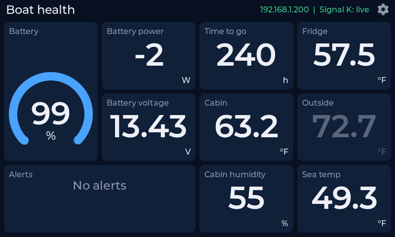
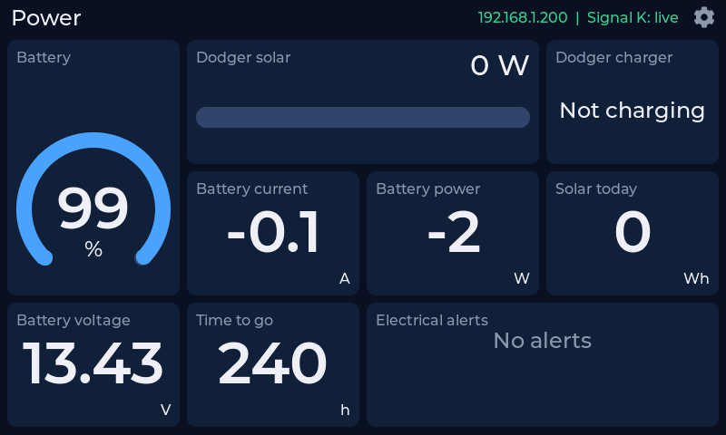
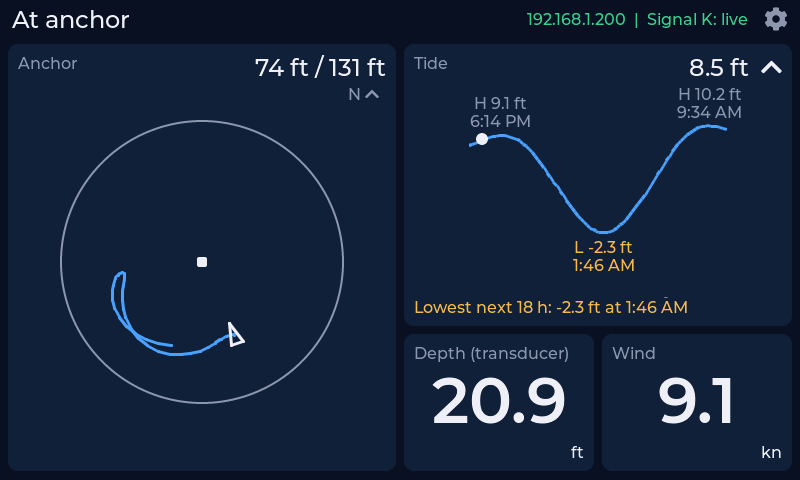
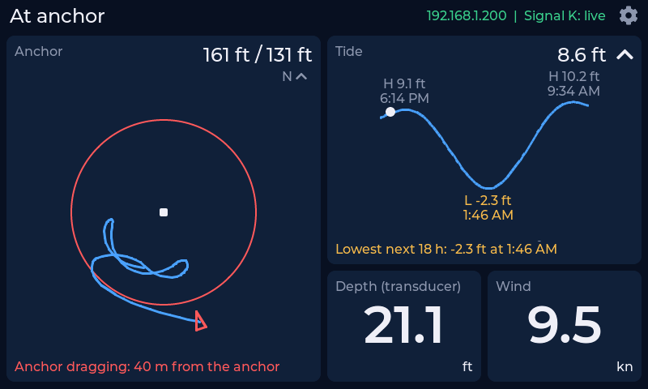
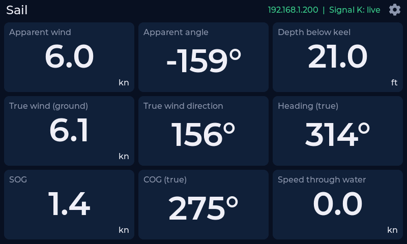
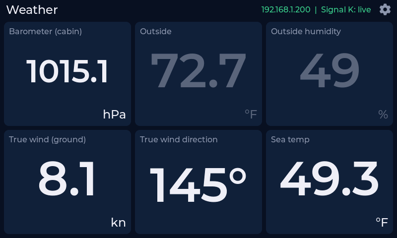
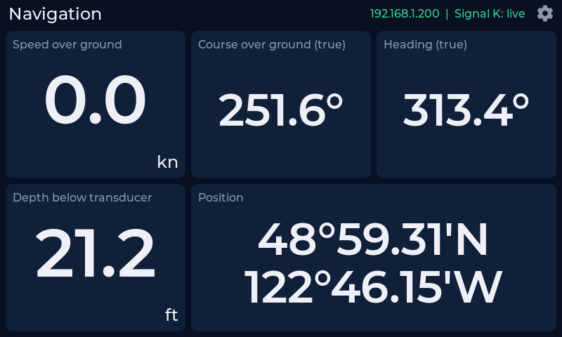
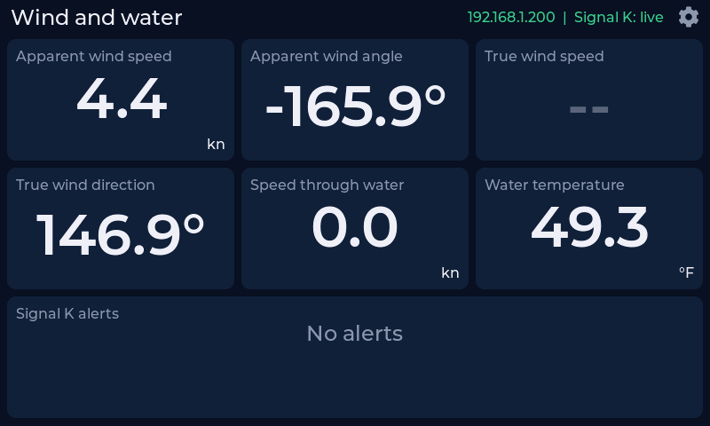
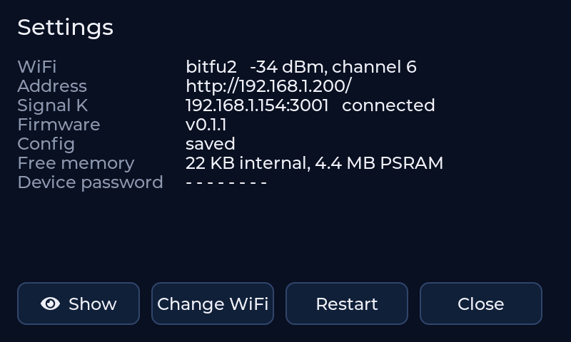

# telltale_fw

Firmware for Telltale: an ESP32-S3 touch display for Signal K data, with screens defined in config.

Nothing about what is shown is compiled in. Screens, widgets, Signal K paths, units, thresholds and layout all come from a JSON config file on the device. The firmware provides the board support, a Signal K client and a registry of widget types; the config puts them together.

There's no screen editor: describe the screens you want to an AI coding assistant working in this repo, and it writes the config, checks it against the display, sends it and looks at the result (below, [Changing screens](#changing-screens)).

Status: config API, per-screen Signal K subscriptions with metadata, and screen switching by boat state work on the desk; widgets so far: `value`, `ring`, `bar`, `state`, `alert`, `tide`, `anchor`, `label`. Spec and remaining phases: [docs/SPEC.md](docs/SPEC.md).

## What it looks like

Screenshots taken from the display itself (`telltale.py screenshot`), 800×480, with live data from a boat's Signal K server. The anchor shots use a simulated swing and drag, since the boat is at the dock.

| | |
|---|---|
|  |  |
| **Boat health:** battery ring, readings, alerts. Values that stop updating grey out (Outside). | **Power:** a bar for solar, a `state` widget for the charger mode, alerts filtered to `electrical`. |
|  |  |
| **At anchor:** the swing trail (12 h, fading with age, refilled from Signal K history after a restart), the alarm circle, and the boat on its heading. Beside it, the tide curve for the next 18 h with highs, lows and the lowest low ahead. | **Dragging:** the circle and boat turn red with the anchor alarm's own message (hoekens-anchor-alarm). |
|  |  |
| **Sail:** wind, depth, heading and speeds. Degrees sit on the number; other units sit in the corner. | **Weather:** a long reading steps down a size to fit its card. |

Screens switch by themselves with the boat's state (`navigation.state`: moored, anchored, sailing...), and a swipe overrides that for a while.

**Built-in screens** for any boat (standard Signal K paths, in the units set on the server, the server found by mDNS):

| | |
|---|---|
|  |  |

**Also:**
- **Setup from a phone:** with no WiFi saved, the display shows QR codes to join its own hotspot and open a setup page.
- **Settings on the display:** the gear at the top right shows the address, signal, Signal K connection, firmware and the device password.
- **Updates and installs:** firmware updates go over WiFi, with rollback if the new one can't get online. New boards install from the web flasher.
- **Screens are a JSON file:** sent over WiFi and applied without a restart. A bad one is rejected and the last good one kept.

| | |
|---|---|
|  | **Settings:** the gear on any screen opens it. Show reveals the device password, needed to change settings or update from another computer; Change WiFi brings up the setup hotspot. |

## Building

Requires PlatformIO. ESP-IDF 5.5.0 is pulled in by the pinned platform (`espressif32@6.12.0`).

1. Optional: copy `src/secrets.example.h` to `src/secrets.h` (gitignored) and fill in WiFi and a device password, so a development board skips the setup hotspot.
2. `pio run -e lcd7 -t upload --upload-port COM6` — first flash over USB (also needed when the bootloader changes).
3. The built-in config is `data/default_config.json`. It's generic: navigation, wind and water, and alerts, all from standard Signal K paths, in the units set on the Signal K server, with the server found by mDNS. It runs until you send one of your own (below). To try the example boat's screens: `python tools/telltale.py telltale.local put-config examples/sailboat.json`.

## Installing a release

The web flasher on this repo's GitHub Pages site installs the latest release from Chrome or Edge over USB. Releases also carry `telltale-<ver>-full.bin`, which esptool writes at `0x0`. A release build, tagged `v*`, is made by `.github/workflows/release.yml`.

## Setting up a display

With no WiFi saved, the display shows **Set up WiFi** with two QR codes. Join its hotspot (`Telltale-XXXX`) with a phone. The setup page opens by itself, or go to `http://192.168.4.1`. Choose the boat's network, and optionally a Signal K server and a device password.

Later, the gear at the top right of the screen opens Settings. It shows the address, the device password, Change WiFi and Restart. On the boat network the setup page is at `http://telltale.local/`, and saving there needs the device password. Details: SPEC §5.6.

## Updating over WiFi

Set `TELLTALE_OTA_PASS` to the device password (Settings on the screen), then:

- `pio run -e lcd7-ota -t upload` — finds the device as `telltale.local`.
- `pio run -e lcd7-ota -t upload --upload-port <ip>` — if mDNS doesn't resolve.

The status line shows progress. A new image that can't get on WiFi within 5 minutes rolls back to the previous one. `http://telltale.local/api/info` shows the running version and partition.

## Changing screens

Screens come from a JSON config (format: SPEC §6, [`docs/config.schema.json`](docs/config.schema.json)). Send it over WiFi; it is checked, saved and shown without a rebuild or reboot. A bad config is rejected with a message and the display keeps what it had.

**With an AI assistant** (the intended way). Open this repo in an AI coding assistant that can run commands, and ask for what you want, for example: *"Add a screen for motoring with RPM, coolant temperature, fuel rate and depth, and switch to it when the boat is motoring."* Everything it needs is here:

- **What the display can show:** `docs/config.schema.json`, SPEC §6, and `GET /api/widgets` on the display (every widget type with its options, defaults and allowed values).
- **What your boat has:** the Signal K server lists every path with its current value, at `http://<server>/signalk/v1/api/vessels/self`.
- **A worked example:** [`examples/sailboat.json`](examples/sailboat.json).
- **A loop to check its work:** `validate` explains anything the firmware would reject, `put-config` applies it, and `screenshot` lets the assistant see the screen as it really looks, so it can fix text that doesn't fit or a layout that's cramped.

Keep your own config in a file of your own (or a private repo) so the next change starts from it.

**By hand**, with the same commands:

```
python tools/telltale.py telltale.local validate my_config.json
python tools/telltale.py telltale.local put-config my_config.json     # needs TELLTALE_OTA_PASS
python tools/telltale.py telltale.local get-config
python tools/telltale.py telltale.local status                        # connection, values, ages
python tools/telltale.py telltale.local reset-config                  # back to the built-in config
python tools/telltale.py telltale.local screenshot shot.png [screen]  # what the display shows, as PNG
```

The previous config is kept as last-known-good and used if the saved one stops loading. The full API is in `src/api.h`.

Example: [`examples/sailboat.json`](examples/sailboat.json), the screens for the sailboat this was first built for. The host tests check every file in `examples/` against the firmware's rules.

## Tests

`sh test/host/run.sh` builds and runs the host tests (config parsing and validation, zones, units, Signal K timestamps) with the system C compiler.

Changes go to `main` through pull requests. Every pull request builds the firmware and runs the host tests (`.github/workflows/ci.yml`), and must pass before it merges. A change that adds behaviour should add host tests for it where it can.

Desk testing away from the boat: run `python tools/sk_relay.py --listen 3001 --target <server>:80` on a PC that can reach the Signal K server, and set the display's Signal K server to that PC on the setup page (or `SK_HOST_OVERRIDE` / `SK_PORT_OVERRIDE` in `secrets.h`).

Board code in `src/board/` is adapted from Waveshare's ESP32-S3-Touch-LCD-7 demo (Espressif example code, CC0-1.0 and Apache-2.0 — headers kept).

## Hardware

First board profile: Waveshare ESP32-S3-Touch-LCD-7 (800×480). Details and power notes: SPEC §3.

## Data source

Signal K only (WebSocket stream). NMEA 2000 direct is out of scope for now.

## License

MIT — see [LICENSE](LICENSE).
